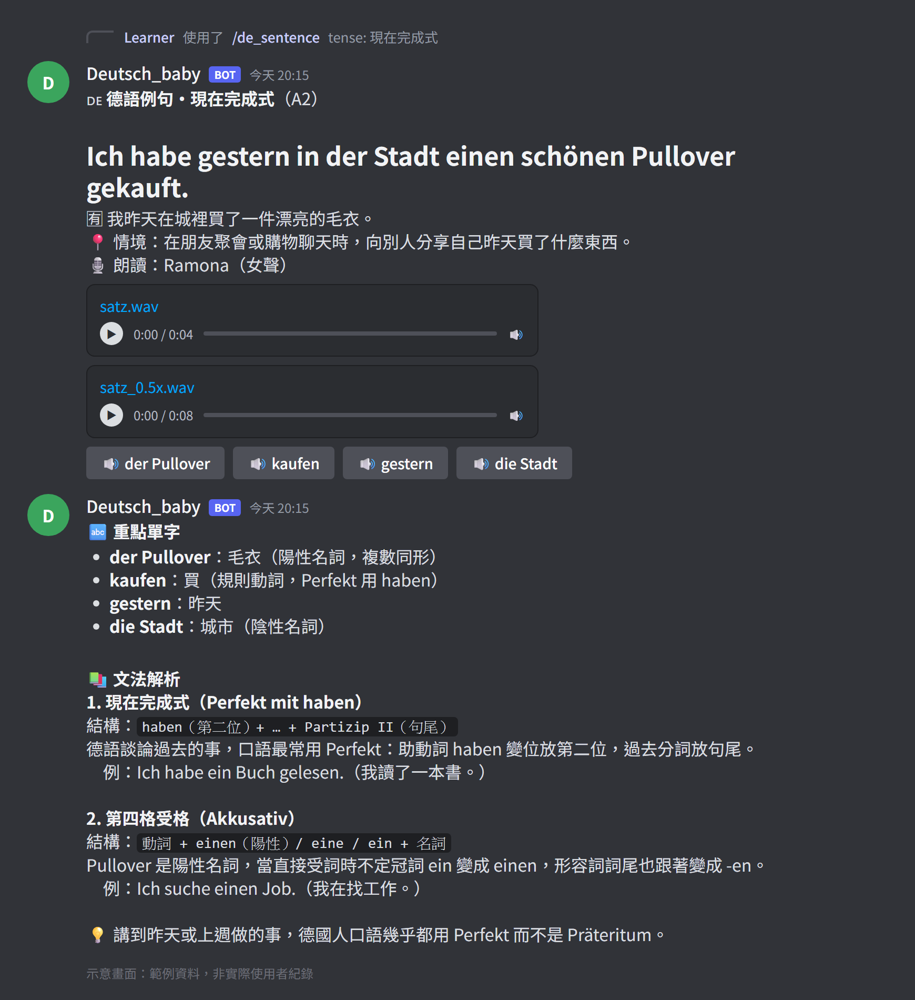
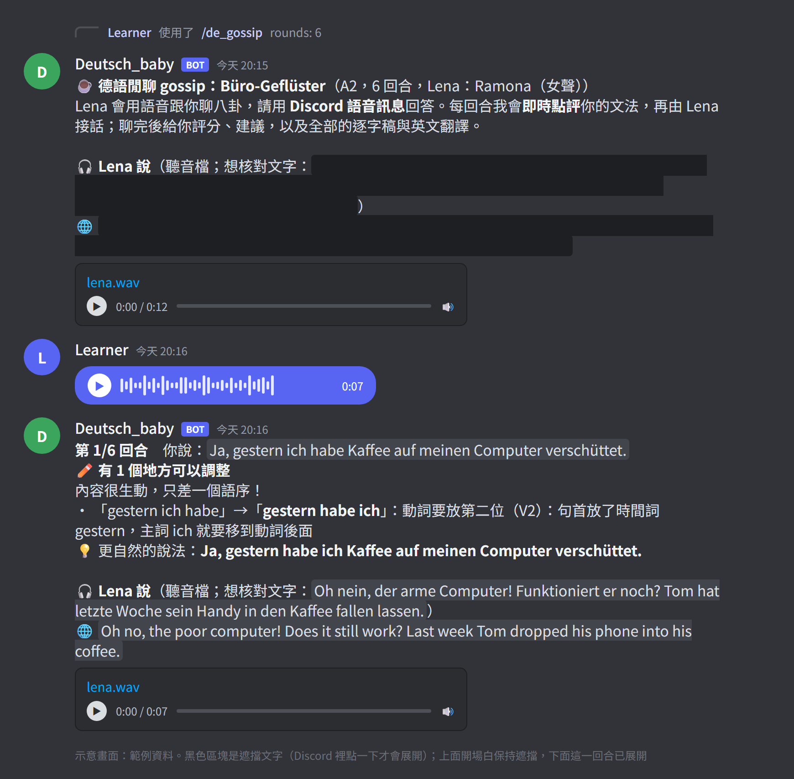
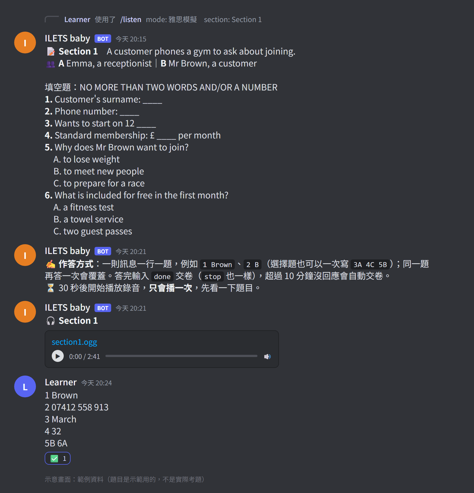
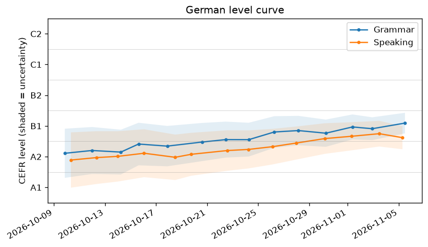
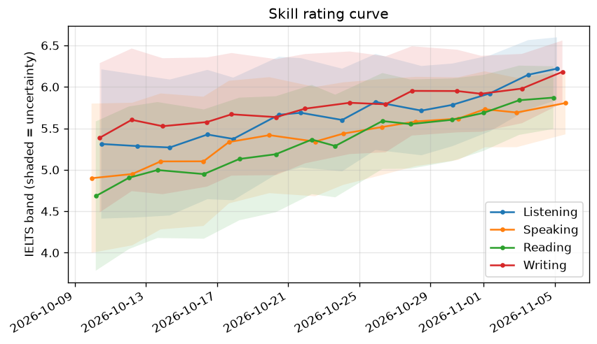
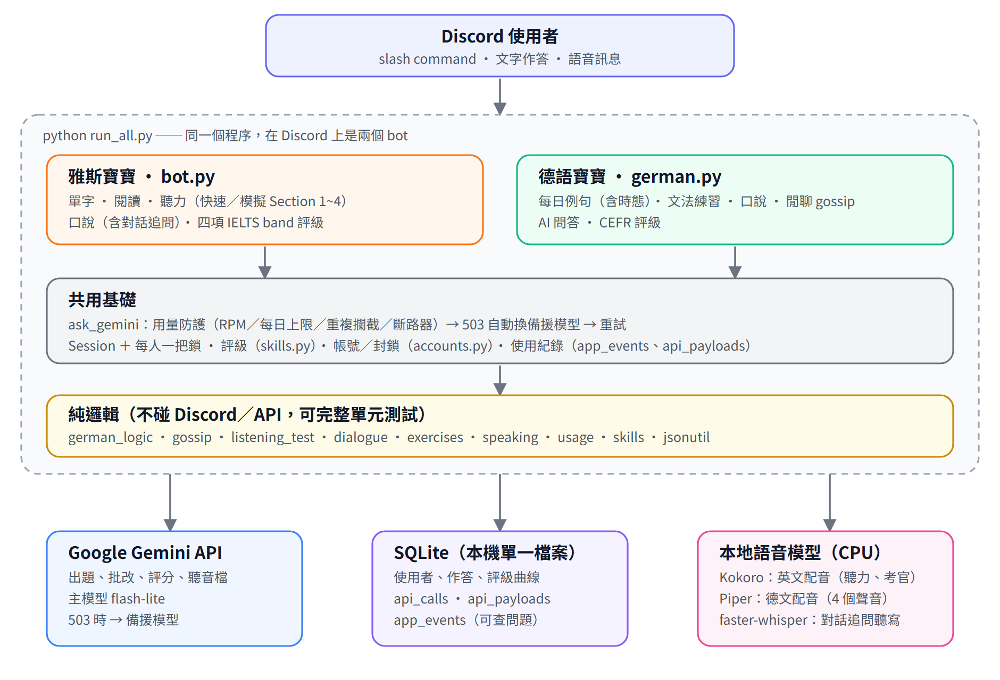

# ilet_helper — 雅斯寶寶 & 德語寶寶

兩隻在自己電腦上跑的 Discord 學習 bot，用 Google Gemini 出題、批改、評分，語音（聽力、口說對話）全部在**本機**合成，練習紀錄存在**本機** SQLite：

- **雅斯寶寶 / ILETS baby**：雅思（IELTS）單字、閱讀、聽力（含 Section 1~4 模擬測驗）、口說，四項 band 評級。
- **德語寶寶 / Deutsch_baby**：德語每日例句（可選時態）、文法練習、口說、**gossip 閒聊（每句即時點評文法）**、AI 問答，CEFR 評級。

> *English:* two self-hosted Discord bots for IELTS and German practice. Gemini generates and grades the exercises; speech synthesis (Kokoro / Piper) and speech recognition (faster-whisper) run locally; everything is stored in a local SQLite file. The UI language is Traditional Chinese. Setup instructions below are in Chinese; the commands are copy-pasteable.

> 本專案與 IELTS 官方、各考試機構沒有關係，題目與批改由 AI 產生，僅供練習參考。

## 畫面一覽

> 下面三張是**示意畫面**：用虛構的範例內容、搭配專案真正的排版程式（[`docs/mockups/build.py`](docs/mockups/build.py)）畫出來的，不是 Discord 的實際截圖，也沒有任何真實使用者的資料。評級曲線圖同樣由專案真正的繪圖函式、以虛構的紀錄繪製。

| 德語例句（現在完成式）＋發音 | 德語閒聊：即時文法點評 |
|---|---|
|  |  |

| 雅思聽力模擬測驗（Section 1） | 評級曲線 |
|---|---|
|  |   |

## 功能

### 雅斯寶寶（IELTS）

| 指令 | 說明 |
|---|---|
| `/register` | 第一次使用：設定聽說讀寫四項的基礎分數 |
| `/search` `/word_quiz` `/word_review` | 查單字（釋義、同義替換、搭配詞、例句）、互動拼字測驗、從弱點單字複習 |
| `/reading` `/reading_pdf` | 閱讀練習：開放授權的真實文章改編或原創短文；也可上傳 PDF 讓 AI 寫一篇新的並出題 |
| `/listen` | 聽力：**快速練習**（短錄音 5 題）或**雅思模擬**（Section 1~4，每段 10 題，或完整 40 題換算 band；多說話者配音） |
| `/speaking` | 口說模擬（Part 1/2/3）：考官語音提問、你用語音訊息回答；可選「對話追問」（本機語音辨識走分支，省 API） |
| `/level` `/progress` `/stats` `/weekly` | 四項評級、評級曲線圖、學習統計、週報 |
| `/usage` `/users` `/block` `/unblock` | Gemini 用量；管理員專用的使用者管理 |

### 德語寶寶（Deutsch_baby）

| 指令 | 說明 |
|---|---|
| `/de_register` | 第一次使用：選 CEFR 程度（A1~C1） |
| `/de_today` `/de_sentence` | 每日例句／依你的程度即時生成例句（可選**現在式、過去式、現在完成式、未來式**，預設隨機）；附原速與 0.5 倍速語音、重點單字發音按鈕、文法解析 |
| `/de_practice` | 針對弱點文法出題（克漏字、選擇、重組、翻譯） |
| `/de_speak` | 口說練習：老師語音提問、你用語音回答，結束後評分與建議 |
| `/de_gossip` | **閒聊**：和 Lena 用語音聊指定回合數；每回合即時點評文法對錯並給更自然的說法，結束後評分，附遮擋的逐字稿與英文翻譯 |
| `/de_ask` | 針對例句或練習題提問 |
| `/de_level` `/de_progress` `/de_stats` | 評級（顯示成 `B1+ (3.76)`）、曲線圖、各文法點答對率 |

每天固定時間自動發「今日德語例句」到指定頻道（選填）。

## 架構



兩隻 bot 同一個程序、同一個 SQLite、同一套 Gemini 用量防護。詳細說明見 [`docs/ARCHITECTURE.md`](docs/ARCHITECTURE.md)。幾個設計重點：

- **用量防護**：全域／個人每分鐘上限、每日上限、重複請求攔截、連續失敗的斷路器；主模型回 503 時自動改用備援模型。
- **純邏輯與 Discord 分離**：prompt、解析、判分、排版都能不連網單元測試。
- **每次練習都留痕跡**：指令、錯誤（含 traceback）、Gemini 提示詞與回應原文都記在資料庫，問題回報可以從 log 查到（`python logview.py`）。
- **評級**：對錯題用 Elo 式更新，口說／寫作用 AI 給的 band 做卡爾曼式更新，久不練習不確定度會回升。

## 快速開始

**需求**：Python 3.11、約 2 GB 磁碟空間（語音模型約 1.1 GB ＋ Python 套件）、一台能長時間開著的電腦（關機 bot 就離線）。開發與測試環境是 WSL2 Ubuntu 20.04；其他系統沒有測過（macOS／Linux 預期可用，Windows 原生請用 WSL）。模型下載網址與腳本的語法已驗證有效，但「全新環境從頭安裝」的完整流程作者還沒有完整走過一遍，如果遇到缺套件或錯誤，歡迎開 issue。

### 1. 下載與安裝

```bash
git clone https://github.com/<你的帳號>/ilet_helper.git
cd ilet_helper

python3.11 -m venv .venv
source .venv/bin/activate            # Windows PowerShell：.venv\Scripts\Activate.ps1
sudo apt install libsndfile1         # 只有 Linux / WSL 需要
pip install -r requirements.txt

bash scripts/download_models.sh      # 本地語音模型，約 600 MB（可選 en / de / de-min，見腳本說明）
```

### 2. 建立 Discord bot

1. 到 [Discord Developer Portal](https://discord.com/developers/applications) → **New Application** → 左側 **Bot**。
2. **Reset Token** 並複製（只會顯示一次）；往下把 **Message Content Intent** 打開。
3. 左側 **OAuth2 → URL Generator**：Scopes 勾 `bot`、`applications.commands`；Bot Permissions 勾 *View Channels、Send Messages、Attach Files、Read Message History、Add Reactions*。用產生的網址把 bot 邀進你的伺服器。
4. 想用德語寶寶，就**再建立一個 Application / Bot** 重複以上步驟（兩隻 bot 各有自己的 token）。
5. Discord 設定 → 進階 → 開啟「開發者模式」，就能對伺服器、頻道、自己的頭像按右鍵「複製 ID」。

### 3. 設定 `.env`

```bash
cp .env.example .env
```

打開 `.env`，至少填 `DISCORD_TOKEN` 與 `GEMINI_API_KEY`（[在這裡申請](https://aistudio.google.com/apikey)，有免費額度）。建議同時填 `DISCORD_GUILD_ID`（你的伺服器 ID；slash command 會立即生效，bot 也只會待在這個伺服器）與 `OWNER_ID`（你自己的使用者 ID，成為管理員）。要用德語寶寶就再填 `GERMAN_DISCORD_TOKEN`。每個設定項都有註解，說明在 [`.env.example`](.env.example)。

### 4. 啟動

```bash
python run_all.py        # 兩隻 bot 同進程；沒填 GERMAN_DISCORD_TOKEN 就只啟動雅斯寶寶
# python bot.py          # 只跑雅斯寶寶
```

在 Discord 輸入 `/register`（雅思）或 `/de_register`（德語）開始。**不要同時開多個實例**，否則每個回覆都會重複。

### 5.（建議）跑測試

```bash
python -m unittest discover -s tests -v     # 不連網、不需要 token、不需要模型
```

`tests/flow_*.py`（假 Discord 物件的流程測試）與 `tests/live_*.py`（真的呼叫 Gemini）需要額外設定，用法寫在各檔案開頭。

## 隱私與安全

- **秘密只放 `.env`**，已被 `.gitignore` 擋住。`.env.example` 只有假的範例值。
- **上傳前掃描**：`python scripts/check_secrets.py` 會檢查被追蹤的檔案有沒有 token、API key、Discord ID、email，並且比對你本機 `.env` 的每一個值。加上 `--history` 連 git 歷史一起掃。啟用 commit 前自動掃描：

  ```bash
  git config core.hooksPath .githooks
  ```
- **commit 的作者信箱會公開**：push 之前建議改用 GitHub 的 noreply 信箱（GitHub → Settings → Emails → *Keep my email addresses private*），再 `git config user.email "<ID>+<帳號>@users.noreply.github.com"`。
- **資料都在本機**：`ielts_learning.db`（使用者作答與評級）、`logs/`、`audio_cache/`、`records/`（週報）全部被 `.gitignore` 擋住。**請注意**資料庫的 `api_payloads` 與 `app_events` 會保存使用者的輸入內容（作答文字、語音逐字稿、提問），這是為了讓問題能被追查；保存天數用 `PAYLOAD_RETENTION_DAYS`、`EVENT_RETENTION_DAYS` 控制（`PAYLOAD_RETENTION_DAYS=0` 就完全不保存提示詞與回應）。
- **只服務你指定的伺服器**：設定 `DISCORD_GUILD_ID` / `ALLOWED_GUILD_IDS` 後，bot 被加進其他伺服器會自動退出，避免陌生人消耗你的 Gemini 額度。
- **語音資料**：使用者傳的語音會送給 Gemini 評分（Google 的 API），處理完會從 `audio_cache/` 刪除；英文對話追問的語音辨識與所有 TTS 都在本機完成。
- 如果你不小心把 token 公開了，請立刻到 Developer Portal **Reset Token**、到 Google AI Studio 刪除並重建 API key。

## Gemini 額度

預設模型 `gemini-3.5-flash-lite`（免費額度），主模型回 503（過載）時自動改用 `GEMINI_FALLBACK_MODEL`。`GEMINI_RPM_LIMIT` / `GEMINI_RPD_LIMIT` / `USER_RPM_LIMIT` 預設值對應免費額度並留餘裕，換模型或升級付費時請依你的額度調整。一場練習的呼叫次數大約：德語閒聊「回合數＋2」、雅思口說對話追問約 2、聽力模擬每段 1~2。`/usage` 可以看用量與各功能的效益。

## 開發

```
python -m unittest discover -s tests -v    單元測試
python -m pyflakes *.py                    靜態檢查
python logview.py events|errors|user <id>|calls|call <id>    查使用紀錄與 Gemini 呼叫
python docs/mockups/build.py               重新產生 README 的示意畫面
```

- 工作守則與每個功能的設計筆記：[`CLAUDE.md`](CLAUDE.md)；改動歷程：[`WORKLOG.md`](WORKLOG.md)。
- `.github/workflows/tests.yml` 會在 push 時跑單元測試與秘密掃描。

## 已知限制

- Gemini（flash-lite）有時抓不到有瑕疵的題目、偶爾拼錯德文；程式只驗證結構（例如填空題的答案必須能填回句子），不驗證語言正確性。
- 德語閒聊的發音評分只能依各回合聽音檔時留下的備註估計，參考價值有限。
- 聽力模擬沒有地圖／圖表題。
- 按鈕 6 小時後失效，bot 重啟後舊訊息的按鈕也失效。
- slash command 與語音訊息的實際互動無法自動測試（只用假 Discord 物件測流程），需要在 Discord 上手動驗證。

## 授權與第三方

- 本專案程式碼以 [MIT](LICENSE) 授權。
- 語音模型**不在**本 repo 內，由 `scripts/download_models.sh` 從原處下載，授權各自獨立，請自行確認符合你的用途：[Kokoro](https://github.com/thewh1teagle/kokoro-onnx)（Apache-2.0）、[Piper 德語聲音](https://huggingface.co/rhasspy/piper-voices)（Thorsten、Kerstin 為 CC0；Ramona、Karlsson 來自 [M-AILABS 資料集](https://www.caito.de/2019/01/03/the-m-ailabs-speech-dataset/)，條件見其 model card）、[faster-whisper](https://github.com/SYSTRAN/faster-whisper)（MIT）。
- 閱讀練習的真實文章只取自開放授權／公有領域來源（Our World in Data、NASA、NIST、Global Voices、維基媒體系列），並遵守各站的 robots.txt；不收錄 BBC。
