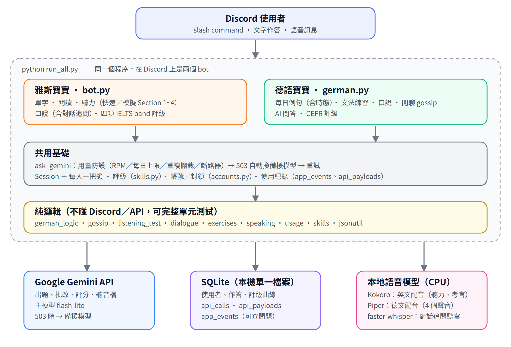

# 架構說明

兩隻 Discord bot 共用**一個程序、一個 SQLite 資料庫、一套 Gemini 用量防護**。



## 目錄一覽

```
run_all.py          入口：同時啟動兩隻 bot（一隻登入失敗不影響另一隻）
bot.py              雅斯寶寶（IELTS）＋所有共用基礎：資料庫、評級、記錄、ask_gemini、用量防護、各種 Session
german.py           德語寶寶：指令、Session、Piper 配音、每日例句排程、按鈕
german_logic.py     德語純邏輯：prompt、解析、驗證、判分、格式化（不碰 Discord）
gossip.py           德語閒聊（gossip）純邏輯：開場／回合／評分 prompt、解析、即時點評排版、報告
speaking.py         雅思口說純邏輯＋共用的劇透遮罩切段 / 訊息打包
dialogue.py         口說「對話追問」純邏輯：對話樹 prompt/解析、關鍵字比對、輪次狀態
listening_test.py   聽力模擬測驗（Section 1~4）純邏輯：prompt、解析驗證、作答解析、判分、band 換算
exercises.py        閱讀／聽力題的 prompt、證據定位、PDF/改編 prompt
reports.py          週報
skills.py           評級演算法（純計算）
usage.py            Gemini 用量防護與分析（純邏輯）
accounts.py         使用者註冊 / 封鎖 / 資料遷移
sources.py          真實文章來源（開放授權；trafilatura；遵守 robots.txt）
asr.py              本地語音轉文字（faster-whisper）
tts.py              英文本地 TTS（Kokoro）；德文用 Piper（在 german.py 的 synth）
jsonutil.py         寬鬆 JSON 解析（Gemini 偶爾回壞 JSON）
logview.py          查 log / 事件 / Gemini 呼叫的命令列工具

scripts/            download_models.sh（下載語音模型）、check_secrets.py（上傳前秘密掃描）
tests/              單元測試（test_*.py，不連網）與流程/實測腳本（flow_*.py、live_*.py）
docs/               本文件與 README 用的圖片
.githooks/          pre-commit：commit 前自動掃描秘密
```

設計原則：**純邏輯與 Discord / Gemini 分開**。`*_logic.py`、`gossip.py`、`listening_test.py`、`dialogue.py` 這類模組不 import discord、不呼叫 API，所以能用單元測試完整覆蓋；`bot.py` / `german.py` 負責接 Discord 與 Gemini。

## 一次練習怎麼跑（以德語閒聊為例）

1. Discord 使用者輸入 `/de_gossip`，`GermanTree.interaction_check` 設定身分（`usage.current_user`）、檢查封鎖與註冊。
2. 指令呼叫 `ask_gemini` 產生開場白 → Piper 本地配音 → 建立 `GossipSession` 放進 `bot.sessions[(頻道, 使用者)]`。
3. 使用者之後傳語音，`on_message` 依 session 型別分派給 `handle_gossip`（先拿該 session 的鎖）。
4. `handle_gossip` 把音檔連同對話紀錄送 Gemini，得到逐字稿、文法對錯、即時點評與 Lena 的回應 → 排版（`gossip.py`）→ 回覆文字與語音。
5. 回合數到、使用者 `stop`、或閒置逾時，`finish_*` 呼叫評分、更新評級（`skills.py`）、寫資料庫、送出逐字稿（遮擋文字）。

## 共用基礎（bot.py）

### Gemini 呼叫：`ask_gemini`
所有呼叫都走這裡，依序是：

1. **用量防護**（`usage.Guard`）：全域 / 個人每分鐘上限、每日上限、重複 prompt 攔截、連續失敗的斷路器。
2. 主模型 503（過載）→ 立刻改用備援模型 `GEMINI_FALLBACK_MODEL`。
3. 暫時性 5xx → 自動重試（4 秒、10 秒）。
4. 每次呼叫寫進 `api_calls`（模型、token、延遲、錯誤）與 `api_payloads`（提示詞與回應原文）。

壞 JSON 視為可恢復錯誤：`jsonutil.loads_lenient` 加重試；題目另外在解析時驗證結構（例如克漏字的完整句必須等於「把答案填回空格」），壞題直接丟。

### 身分與多使用者
所有資料表都有 `user_id`；身分放在 `usage.current_user`（ContextVar），在 `interaction_check`、`on_message`、背景逾時處理裡設定。背景任務沒有指令可帶身分，必須自己設定。管理員 = `OWNER_ID`。伺服器白名單 `ALLOWED_GUILD_IDS`，被加進其他伺服器會自動退出。

### Session 與並發
- 雅斯寶寶：`bot.quizzes[(channel_id, user_id)]` → 各種 Session；德語寶寶：`GermanBot.sessions`。
- discord.py 會讓 `on_message` 同時執行，所以**每個 (頻道, 使用者) 有一把鎖**；拿到鎖後要重新確認 session 還是同一個（可能剛被 stop 結束）。逾時 watchdog 也要拿同一把鎖。
- 逾時（預設 10 分鐘）自動結束並評分；啟動時 `recover_abandoned_sessions()` 收掉上次殘留的 session。

### 評級（`skills.py`）
每項技能 `(rating, rd)`：對錯題用 Elo 式更新；口說 / 寫作用 Gemini 給的 band 做卡爾曼式更新；久不練習不確定度（rd）回升；單次練習對單項最多動 0.4。德語用數值刻度 A1=1.5 … C2=6.5，顯示成「B1+ (3.76)」。

### 記錄系統
- `logs/bot.log`（輪替 5MB × 10）。
- 資料庫：`app_events`（指令、錯誤含 traceback、被忽略的訊息、逾時…）、`api_calls`、`api_payloads`、`api_events`（用量防護事件）。
- 查詢：`python logview.py events|errors|user <id>|calls|call <id>`。
- 隱私：`api_payloads` 與 `app_events.detail` 會包含使用者輸入的內容（作答文字、語音轉錄、提問）；保存天數見 `.env` 的 `PAYLOAD_RETENTION_DAYS` / `EVENT_RETENTION_DAYS`。

## 本地模型

| 用途 | 模型 | 位置 |
|---|---|---|
| 英文語音（聽力、考官） | Kokoro（ONNX） | `models/kokoro-v1.0.onnx`、`models/voices-v1.0.bin` |
| 德文語音 | Piper（4 個聲音） | `models/de/*.onnx` |
| 英文語音辨識（對話追問） | faster-whisper `small.en` | `models/whisper/`（第一次使用自動下載） |

安裝見 [`scripts/download_models.sh`](../scripts/download_models.sh)。

## 更細的設計筆記
每個功能的實作細節、踩過的坑與已知限制，寫在專案根目錄的 [`CLAUDE.md`](../CLAUDE.md)（給協作者與 AI 助手看的工作守則），改動歷程在 [`WORKLOG.md`](../WORKLOG.md)。
